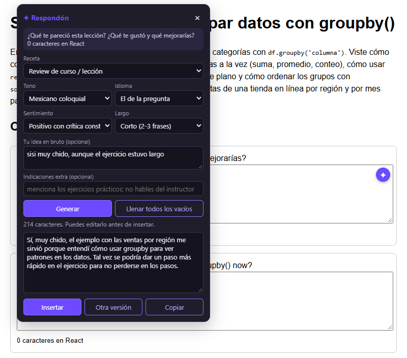
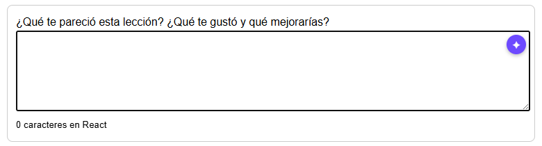
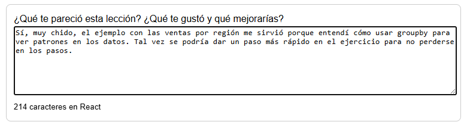
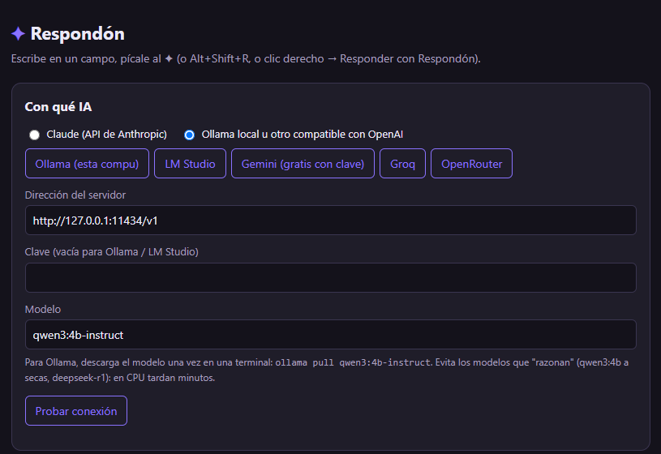

<p align="center">
  <a href="README.md">English</a> · <b>Español</b>
</p>

<div align="center">


# Respondón

### Escribe "sisi muy chido" y te devuelve una review que suena a ti.

Extensión de Chrome y Edge que llena cuadros de texto con IA. Lee la pregunta
y la página, así que la respuesta habla de la lección de verdad. Funciona con
Claude o con un modelo gratis en tu propia compu.

[](LICENSE)
[](https://github.com/leostriker111/Respondon/actions/workflows/revisar.yml)
[](https://github.com/leostriker111/Respondon/releases/latest)




</div>

---

## Qué es

Una **extensión del navegador**. Le das clic a un cuadro de texto en cualquier
página y aparece un ✦ chiquito en su esquina, como el botón de Grammarly. Le
picas y se abre un panel donde eliges qué tipo de campo es, el tono, el
idioma, el sentimiento y el largo. También puedes escribir tu idea en dos
palabras. Respondón escribe el texto, tú lo lees, y **Insertar** lo mete en el
cuadro.

Antes de escribir lee tres cosas: la pregunta de arriba del campo, el texto
de alrededor y el contenido principal de la página. Por eso la respuesta
menciona `groupby()` y las ventas por región en vez de decir "excelente
contenido, muy útil".

## Propósito y alcance

**Por qué existe.** Los cursos en línea piden opinión después de cada
lección, y aunque sea honesta, redactarla se lleva cinco minutos. Respondón
nació para las reviews de las lecciones de TripleTen (analista de datos). Lo
que uno tiene en la cabeza es "sisi muy chido, el ejercicio estuvo largo", y
lo que el formulario quiere es un párrafo.

**Qué abarca.** Reviews de cursos y lecciones, preguntas abiertas de tarea,
comentarios en foros, retroalimentación a un compañero, autoevaluaciones,
buzones de sugerencias, mensajes, y pulir o expandir algo que ya escribiste.
Funciona con `<textarea>` normales, editores enriquecidos `contenteditable`,
formularios hechos en React y campos dentro de ventanas modales.

**Lo que no hace, a propósito.** **Nunca envía el formulario**: tú lees el
texto y picas el botón de la página. No llena estrellas ni calificaciones
numéricas. No se inventa datos tuyos: las instrucciones le prohíben inventar
calificaciones, fechas o nombres.

**A dónde va.** A la Chrome Web Store y a Complementos de Edge, para que
instalarla sea un clic y no cuatro.

## Índice

**Para usarla**
- [Galería](#galería)
- [Instalar](#instalar)
- [Escoger la IA](#escoger-la-ia)
- [Cómo se usa](#cómo-se-usa)
- [Qué sale de tu compu](#qué-sale-de-tu-compu)
- [Lo que no hace (todavía)](#lo-que-no-hace-todavía)

**Para meterle mano**
- [Contribuir](#contribuir)
- [De qué está hecha](#de-qué-está-hecha)
- [El camino del clic al texto](#el-camino-del-clic-al-texto)
- [Problemas, y las decisiones que forzaron](#problemas-y-las-decisiones-que-forzaron)
- [Desarrollo](#desarrollo)

## Galería

<table>
<tr>
<td width="50%" valign="top">
<br>
<sub><b>1.</b> Clic en un cuadro de texto: aparece el ✦ en la esquina de arriba a la derecha (la de abajo es de Grammarly).</sub>
</td>
<td width="50%" valign="top">
<br>
<sub><b>2.</b> Después de <b>Insertar</b>: el texto ya está en el campo y el estado de React de la página lo sabe. <kbd>Ctrl+Z</kbd> lo deshace.</sub>
</td>
</tr>
</table>

<div align="center">
<br>
<sub>La página de opciones: escoges la IA con un botón, pruebas la conexión y editas cada preset.</sub>
</div>

## Instalar

**1. Descarga** el último
[`Respondon-vX.Y.Z.zip` de Releases](https://github.com/leostriker111/Respondon/releases/latest)
y descomprímelo en un lugar donde se pueda quedar. El navegador la carga desde
esa carpeta, así que no la borres después.

**2. Cárgala** en el navegador:

| Chrome / Brave | Edge |
|---|---|
| Abre `chrome://extensions` | Abre `edge://extensions` |
| Prende **Modo de desarrollador** (arriba a la derecha) | Prende **Modo de desarrollador** (barra de la izquierda) |
| **Cargar descomprimida** → la carpeta que descomprimiste | **Cargar desempaquetada** → la carpeta que descomprimiste |

**3. Escoge la IA** (siguiente sección) y pica **Probar conexión**: debe
decir "Funciona ✓".

En las pestañas que ya estaban abiertas hay que recargar (F5) para que salga
el ✦.

O clónala y carga la carpeta clonada igual:

```bash
git clone https://github.com/leostriker111/Respondon.git
```

## Escoger la IA

Clic en el icono ✦ de la barra del navegador para abrir las opciones.

| Opción | Costo | Qué poner |
|---|---|---|
| **Ollama** en tu compu (por omisión) | Gratis, sin internet. 15-30 s la primera, ~5-20 s las siguientes | Instala [Ollama](https://ollama.com) y luego `ollama pull qwen3:4b-instruct` |
| **Claude** | Opus 5.5: 1-2 centavos de dólar por review. Haiku 5.5: casi nada | Tu clave de console.anthropic.com |
| **Gemini** | Gratis con límite diario | Botón **Gemini** + clave de aistudio.google.com |
| Groq / OpenRouter / LM Studio | Depende del modelo | Su botón + su clave |

Todo lo que no es Claude usa el formato `/chat/completions` compatible con
OpenAI, así que cualquier servidor que lo hable también sirve: escribe su
dirección y su modelo a mano.

**En Ollama, nada de modelos que "razonan" antes** (`qwen3:4b` a secas,
`deepseek-r1`). Escriben un par de miles de tokens escondidos antes de
contestar, y en CPU eso son minutos por review. Las variantes `-instruct`
contestan directo.

## Cómo se usa

Hay tres formas de abrir el panel:

| Haz esto | Dónde sirve |
|---|---|
| Clic en el campo y luego en el **✦** de su esquina | Cuadros de varias líneas y editores enriquecidos |
| **Alt+Shift+R** dentro del campo | Cualquier campo, también los de una línea |
| **Clic derecho → Responder con Respondón** | Cualquier campo editable |

Y en el panel:

| Control | Qué hace |
|---|---|
| **Receta** | Qué tipo de campo es: review de curso o lección, respuesta abierta, comentario en foro, feedback a un compañero, autoevaluación, sugerencia, mensaje, pulir lo que ya escribí, expandir mi idea, o libre. |
| **Tono** | Amigable, casual, profesional, formal, entusiasta, neutro, mexicano coloquial, directo, académico, con humor. |
| **Idioma** | De fábrica, *el de la pregunta*: una pregunta en inglés en una página en español se contesta en inglés. O lo fuerzas: español (México o neutro), inglés (EE. UU. o Reino Unido), portugués o francés. |
| **Sentimiento** | Positivo, muy positivo, positivo con crítica constructiva, balanceado, neutral, negativo pero educado. |
| **Largo** | Una frase, corto (2-3), un párrafo, o largo (2-3 párrafos). |
| **Tu idea en bruto** | Tu idea, tan floja como quieras: "sisi muy chido, muy largo". |
| **Indicaciones extra** | "Menciona los ejercicios prácticos; no hables del instructor". |
| **Generar** / <kbd>Ctrl+Enter</kbd> | Escribe el texto. Mientras espera va contando los segundos. |
| **Llenar todos los vacíos** | Recorre cada cuadro de texto vacío de la página, uno por uno, leyendo la pregunta de cada uno. |
| **Insertar** / **Otra versión** / **Copiar** | Lo mete al campo, lo intenta de nuevo o lo copia. Puedes editar el texto antes de insertarlo. |

Recuerda tu última elección. Cada preset es solo un nombre más la
instrucción que lee la IA. En la página de opciones los editas, agregas los
tuyos o regresas a los de fábrica: el *nombre* es lo que ves en el menú y la
*instrucción* es lo que lee la IA.

## Qué sale de tu compu

Con **Ollama**, nada: la petición va a `127.0.0.1`.

Con un proveedor en la nube, cada petición manda:

- el título de la página y su dirección **sin** los `?parámetros`;
- hasta 4,000 caracteres del texto principal de la página;
- la pregunta del campo, el texto de alrededor y lo que ya tenga escrito;
- tus elecciones, tu idea en bruto y tus indicaciones extra.

Las claves se guardan en `chrome.storage.local`: se quedan en este perfil del
navegador y no se sincronizan a tus otras compus. Respondón no tiene servidor
propio ni estadísticas de uso.

## Lo que no hace (todavía)

| Qué | Estado |
|---|---|
| **No está en las tiendas** | Se instala como extensión descomprimida, o sea, con Modo de desarrollador. Chrome a veces avisa al arrancar que hay extensiones de desarrollador. |
| **Solo Chrome y sus parientes** | Chrome, Edge, Brave, Opera. Firefox necesita una adaptación (ver Contribuir). |
| **Solo texto** | Nada de estrellas, deslizadores ni opción múltiple. |
| **Solo sabe lo que está en la página** | Si la lección está en un video o en otra pestaña, la review sale más genérica. Usa *Indicaciones extra* para decirle de qué trató. |
| **Los modelos locales son más lentos** | En una laptop sin GPU dedicada, un modelo de 4B escribe a 6-18 tokens por segundo. Bien para una review, lento para *llenar todos*. |
| **Sitios que bloquean extensiones** | En páginas con iframes aislados o shadow roots cerrados alrededor del campo, el ✦ puede no salir. Alt+Shift+R y el clic derecho de todos modos lo intentan. |

<br>

---

<div align="center">

## 🔧 Para desarrolladores

*Todo lo de arriba es lo que hace. Todo lo de abajo es cómo lo hace.*

</div>

---

### Contribuir

Cosas concretas donde hace falta ayuda:

- **Adaptarla a Firefox.** Las diferencias principales: `browser.*` en vez de
  `chrome.*`, un script de fondo en vez de service worker, y comprobar que la
  regla de `declarativeNetRequest` con `tabIds: [-1]` se porta igual.
- **Subirla a la Chrome Web Store y a Complementos de Edge.** Hace falta una
  página de política de privacidad (el texto es básicamente
  [Qué sale de tu compu](#qué-sale-de-tu-compu)) y capturas para la tienda.
- **Pruebas.** Todavía no hay en el repo. La página de prueba manual, con un
  textarea de React, un `contenteditable` y un `<dialog>`, podría volverse una
  batería de Playwright.
- **Presets en otros idiomas.** Los *nombres* de los presets están en
  español. Un juego en inglés (o un selector de idioma para la interfaz) la
  haría más amigable.

Si reportas un error, di el sitio, el tipo de campo (¿textarea, editor
enriquecido, dentro de un modal?) y el proveedor que usabas.

### De qué está hecha

**JavaScript a pelo, sin compilar.** La carpeta se carga tal cual y cada
archivo se lee sin empaquetador, sin framework y sin `node_modules`. Por lo
mismo, a Claude se le habla con `fetch` y no con el SDK.

| La parte difícil | Quién la resuelve |
|---|---|
| Mostrar el ✦ y el panel sin que el CSS de la página los rompa | Un Shadow DOM cerrado en `campo.js` |
| Escribir en campos de React y que la página se entere | `document.execCommand("insertText")`, y si no se puede, el *setter* nativo + evento `input` |
| Hablarle a Claude desde el navegador | `fetch` con el encabezado `anthropic-dangerous-direct-browser-access` |
| Hablarle a Ollama, Gemini, Groq… | Una sola llamada `/chat/completions` compatible con OpenAI |
| Que Ollama no conteste 403 a la extensión | Una regla de sesión de `declarativeNetRequest` que quita el `Origin` |
| Que el service worker no se duerma con una respuesta lenta | Un latido cada 20 segundos mientras espera |

Son unas 1,150 líneas en cinco archivos:

```
manifest.json    permisos, los content scripts y el service worker
presets.js       las recetas, tonos, idiomas, sentimientos y largos de fábrica
campo.js         lo que vive en la página: el ✦, el panel, leer la pregunta, escribir en el campo
fondo.js         service worker: arma el prompt y habla con Claude u Ollama
opciones.html/js la página de opciones: elegir IA y editar los presets
iconos/          los iconos de la barra
recursos/        logo y capturas de este README (no son parte de la extensión)
```

### El camino del clic al texto

1. `campo.js` escucha `focusin` en toda la página. Si el destino es editable,
   lo guarda como campo actual y pone el ✦ en su esquina superior derecha.
2. Al abrir el panel llena los cinco menús con `cargarPresets()`, que junta lo
   que editaste en opciones encima de los presets de fábrica.
3. **Generar** junta la pregunta del campo (de `aria-labelledby`,
   `aria-label`, `<label>`, el placeholder o el texto más cercano de arriba),
   el texto de alrededor, lo que ya tiene escrito, su `maxlength`, y el
   título, la dirección y el texto principal de la página.
4. Eso viaja a `fondo.js` por `chrome.runtime.sendMessage`.
5. `armarInstrucciones()` arma el prompt de sistema: primera persona, sin
   markdown, sin muletillas de IA, sin inventar datos verificables, respetar
   el límite de caracteres, y luego las cinco instrucciones elegidas.
   `armarPedido()` envuelve los datos de la página en secciones etiquetadas.
6. Llama a Claude o al servidor compatible. `limpiarRespuesta()` quita
   cualquier bloque `<think>` y las comillas de alrededor, y corta en un fin
   de frase si el texto pasa del `maxlength`.
7. El texto regresa al panel. **Insertar** lo escribe en el campo igual que si
   lo tecleaste.

### Problemas, y las decisiones que forzaron

**React no se enteraba del texto.** Un `textarea.value = ...` cambia lo que
ves pero no el estado de React, y el formulario se mandaba vacío. Escribir con
`execCommand("insertText")` va por el mismo camino que teclear y, de pilón,
funciona <kbd>Ctrl+Z</kbd>. Si eso falla, usa el *setter* nativo del prototipo
y dispara `input` y `change`.

**Ollama contestaba 403.** Ollama rechaza las peticiones cuyo `Origin` es
`chrome-extension://…` a menos que configures `OLLAMA_ORIGINS`. En vez de
pedirle a cada quien que ponga una variable de entorno, el service worker
instala una regla de sesión que quita el `Origin`, y solo a las peticiones de
la propia extensión (`tabIds: [-1]`) hacia `localhost` y `127.0.0.1`.

**El panel quedaba muerto dentro de los modales.** Un `<dialog>` abierto con
`showModal()` vuelve inerte todo lo que está afuera, panel incluido. Ahora el
anfitrión se mete dentro del `dialog`, `[role=dialog]` o `[aria-modal]` más
cercano antes de abrir, y las posiciones se corrigen contra el rectángulo del
propio anfitrión.

**El ✦ también desaparecía en los modales.** `showModal()` enfoca el
textarea, y luego el botón que abrió el modal dispara `focusout`, que
escondía el ✦. El temporizador ahora revisa si el foco de verdad se fue del
campo.

**El modelo pensaba cinco minutos.** `qwen3:4b` a secas siempre razona antes
de contestar. Ni `think: false` ni `reasoning_effort: "none"` lo apagaron por
el endpoint compatible, y en CPU eran 160-320 segundos por review. Cambiar el
de fábrica a `qwen3:4b-instruct` lo bajó a 16 segundos. `limpiarRespuesta()`
de todos modos quita un `</think>` suelto por si alguien escoge un modelo que
razona.

**La petición moría a medias.** Chrome duerme al service worker de MV3 a los
~30 segundos sin actividad, y un modelo local puede tardar más. Mientras
espera, `fondo.js` llama `chrome.runtime.getPlatformInfo()` cada 20 segundos,
lo cual cuenta como actividad.

**Preguntas en inglés, respuestas en español.** "Usa el idioma de la página"
era la regla equivocada en un curso en español con una pregunta en inglés. El
preset de idioma de fábrica ahora dice: contesta en el idioma de la pregunta,
y solo si no hay pregunta usa el de la página.

**El ✦ chocaba con Grammarly.** Los dos vivían en la esquina inferior derecha
del campo. El ✦ se pasó a la superior.

### Desarrollo

No hay nada que compilar. Carga la carpeta con **Cargar descomprimida**. Si
cambias un archivo, pica ⟳ en la tarjeta de la extensión en
`chrome://extensions` y recarga la página donde lo estés probando (F5).

La CI ([`revisar.yml`](.github/workflows/revisar.yml)) revisa la sintaxis de
cada script y que exista cada archivo que nombra `manifest.json`. Cuando se
sube una etiqueta `v*`, arma el `.zip` y lo publica como release. Para sacar
una versión nueva, sube el `version` de `manifest.json`, haz commit y empuja
una etiqueta con el mismo número:

```bash
git tag v1.0.1 && git push origin v1.0.1
```

### Licencia

[MIT](LICENSE). Úsala, cámbiala, compártela.

### Proyectos relacionados

- **Grammarly / LanguageTool**: *usa esos para corregir lo que escribiste.*
  Respondón lo escribe a partir de tu idea en dos palabras. Se llevan bien:
  Grammarly se queda con la esquina de abajo y Respondón con la de arriba.
- **[OrderMyPlaylistYT](https://github.com/leostriker111/OrderMyPlaylistYT)**:
  *usa ese para ordenar los videos del curso* que luego vas a tener que
  reseñar.

### Sobre qué se construyó

No es un fork. Usa la plataforma de extensiones de Chrome (Manifest V3,
`declarativeNetRequest`, `contextMenus`, `storage`), la API de Mensajes de
Anthropic y el formato de chat completions compatible con OpenAI que hablan
Ollama, LM Studio, Gemini, Groq y OpenRouter. El truco de
`execCommand("insertText")` para los campos de React es conocimiento viejo de
la comunidad, y es lo mismo en lo que se apoyan los gestores de contraseñas y
otras extensiones de escritura.
