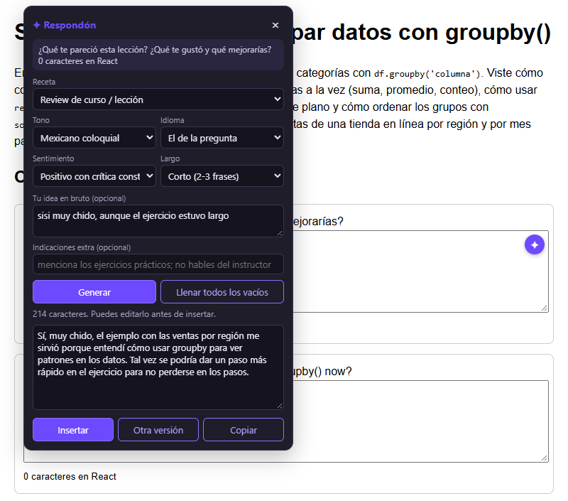
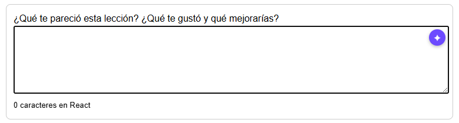
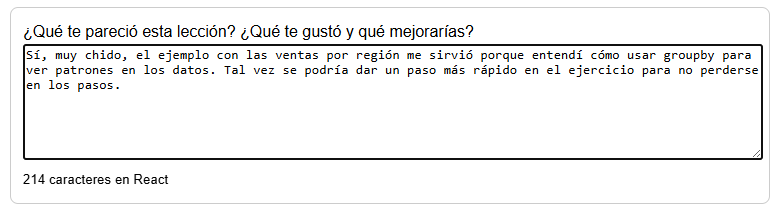
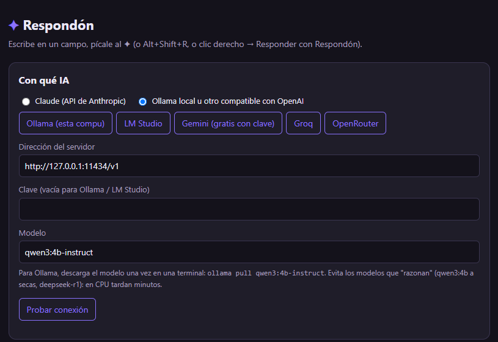

<p align="center">
  <b>English</b> · <a href="LEEME.md">Español</a>
</p>

<div align="center">


# Respondón

### Type "yeah it was cool" and get a review that actually sounds like you.

A Chrome and Edge extension that fills text boxes with AI. It reads the
question and the page, so the answer talks about the actual lesson. It runs
on Claude or on a free model on your own computer.

[](LICENSE)
[](https://github.com/leostriker111/Respondon/actions/workflows/revisar.yml)
[](https://github.com/leostriker111/Respondon/releases/latest)




</div>

---

## What it is

A **browser extension**. You click a text box on any page and a small ✦ shows
up in its corner, the way Grammarly's button does. Click it and a panel opens
where you pick what kind of field it is, the tone, the language, the
sentiment and the length. You can also type your idea in two words. Respondón
writes the text, you read it, and **Insert** puts it in the box.

It reads three things before writing: the question above the field, the text
around it, and the main content of the page. That is why the answer mentions
`groupby()` and sales by region instead of saying "great content, very
useful".

## Purpose and scope

**Why it exists.** Online courses ask for feedback after every lesson, and
honest feedback still takes five minutes to phrase. Respondón was built for
the lesson reviews of a data analyst bootcamp. What the student has in mind
is "yeah it was cool, the exercise was long", and what the form wants is a
paragraph.

**What it covers.** Course and lesson reviews, open questions in homework,
forum comments, feedback to a classmate, self-evaluations, suggestion boxes,
messages, and polishing or expanding something you already wrote. It handles
plain `<textarea>` fields, rich `contenteditable` editors, React forms and
fields inside modal dialogs.

**What it does not do, on purpose.** It **never submits the form**: you read
the text and press the site's button yourself. It does not fill star ratings
or numeric scores. It does not invent facts about you: the instructions tell
the model not to make up grades, dates or names.

**Where it is going.** Into the Chrome Web Store and Edge Add-ons, so that
installing it takes one click instead of four.

## Contents

**Using it**
- [Gallery](#gallery)
- [Install](#install)
- [Choose the AI](#choose-the-ai)
- [How to use it](#how-to-use-it)
- [What leaves your computer](#what-leaves-your-computer)
- [Limits](#limits)

**Working on it**
- [Contributing](#contributing)
- [What it's made of](#what-its-made-of)
- [The path from click to text](#the-path-from-click-to-text)
- [Problems, and the decisions they forced](#problems-and-the-decisions-they-forced)
- [Development](#development)

## Gallery

<table>
<tr>
<td width="50%" valign="top">
<br>
<sub><b>1.</b> Click a text box: the ✦ appears in its top right corner (the bottom right belongs to Grammarly).</sub>
</td>
<td width="50%" valign="top">
<br>
<sub><b>2.</b> After <b>Insert</b>: the text is in the field and the page's own React state knows it. <kbd>Ctrl+Z</kbd> undoes it.</sub>
</td>
</tr>
</table>

<div align="center">
<br>
<sub>The options page: pick the AI with one button, test the connection, and edit every preset.</sub>
</div>

## Install

**1. Download** the latest
[`Respondon-vX.Y.Z.zip` from Releases](https://github.com/leostriker111/Respondon/releases/latest)
and unzip it somewhere it can stay. The browser loads it from that folder, so
don't delete the folder afterwards.

**2. Load it** in the browser:

| Chrome / Brave | Edge |
|---|---|
| Open `chrome://extensions` | Open `edge://extensions` |
| Turn on **Developer mode** (top right) | Turn on **Developer mode** (left sidebar) |
| **Load unpacked**, pick the unzipped folder | **Load unpacked**, pick the unzipped folder |

**3. Choose the AI** (next section) and press **Probar conexión** (test
connection). It should say "Funciona ✓".

Already-open tabs need a reload (F5) before the ✦ shows up in them.

Or clone it, and load the cloned folder the same way:

```bash
git clone https://github.com/leostriker111/Respondon.git
```

## Choose the AI

Click the ✦ icon in the browser toolbar to open the options page.

| Option | Cost | What to set |
|---|---|---|
| **Ollama** on your computer (default) | Free, offline. 15–30 s the first time, ~5–20 s after that | Install [Ollama](https://ollama.com), then `ollama pull qwen3:4b-instruct` |
| **Claude** | Opus 5.5: one or two cents per review. Haiku 5.5: almost nothing | A key from console.anthropic.com |
| **Gemini** | Free, with a daily limit | The **Gemini** button plus a key from aistudio.google.com |
| Groq / OpenRouter / LM Studio | Depends on the model | The matching button plus its key |

Every option except Claude uses the OpenAI-compatible `/chat/completions`
format, so any server that speaks it works too: type its address and model by
hand.

**For Ollama, stay away from models that "think" first** (plain `qwen3:4b`,
`deepseek-r1`). They write a couple of thousand hidden tokens before
answering, which on a CPU means minutes per review. The `-instruct` variants
answer right away.

## How to use it

There are three ways to open the panel:

| Do this | Where it works |
|---|---|
| Click the field, then the **✦** in its corner | Multi-line boxes and rich editors |
| **Alt+Shift+R** inside the field | Any field, single-line inputs included |
| **Right-click → Responder con Respondón** | Any editable field |

Then, in the panel:

| Control | What it does |
|---|---|
| **Receta** (recipe) | What kind of field it is: lesson review, open answer, forum comment, peer feedback, self-evaluation, suggestion, message, polish what I wrote, expand my idea, or free. |
| **Tono** (tone) | Friendly, casual, professional, formal, enthusiastic, neutral, Mexican colloquial, direct, academic, with humour. |
| **Idioma** (language) | By default, *the question's language*: an English question on a Spanish page gets an English answer. Or force Spanish (MX or neutral), English (US or UK), Portuguese or French. |
| **Sentimiento** (sentiment) | Positive, very positive, positive with constructive criticism, balanced, neutral, polite negative. |
| **Largo** (length) | One sentence, short (2–3), one paragraph, or long (2–3 paragraphs). |
| **Tu idea en bruto** | Your raw idea, as lazy as you want: "yeah cool, too long". |
| **Indicaciones extra** | Extra instructions: "mention the practice exercises; don't talk about the instructor". |
| **Generar** / <kbd>Ctrl+Enter</kbd> | Writes the text. A seconds counter runs while it waits. |
| **Llenar todos los vacíos** | Goes through every empty text box on the page, one at a time, reading each one's question. |
| **Insertar** / **Otra versión** / **Copiar** | Put it in the field, try again, or copy it. You can edit the text before inserting it. |

It remembers your last choices. Each preset is just a name plus the
instruction the model reads, and the options page lets you edit them, add
your own, or restore the factory ones.

## What leaves your computer

With **Ollama**, nothing does: the request goes to `127.0.0.1`.

With a cloud provider, each request sends:

- the page title and its address **without** the `?query` part;
- up to 4,000 characters of the page's main text;
- the field's question, the text around it and what it already contains;
- your choices, your raw idea and your extra instructions.

Keys are saved in `chrome.storage.local`, so they stay in this browser
profile and are not synced to your other computers. Respondón has no server
of its own and no analytics.

## Limits

| What | Status |
|---|---|
| **Not in the stores yet** | It installs as an unpacked extension, which means Developer mode. Chrome may show a reminder about developer extensions when it starts. |
| **Chrome and its relatives only** | Chrome, Edge, Brave, Opera. Firefox needs a port (see Contributing). |
| **Text only** | No stars, sliders or multiple choice. |
| **It only knows what is on the page** | If the lesson lives in a video or on another tab, the review will be vaguer. Use *Indicaciones extra* to tell it what the lesson was about. |
| **Local models are slower** | On a laptop without a dedicated GPU, a 4B model writes at 6–18 tokens per second. Fine for one review, slow for *fill all*. |
| **Sites that block extensions** | Pages with strict sandboxed iframes or closed shadow roots around the field may not show the ✦. Alt+Shift+R and the right-click menu still try. |

<br>

---

<div align="center">

## 🔧 For developers

*Everything above is what it does. Everything below is how it does it.*

</div>

---

### Contributing

Concrete things that would help:

- **A Firefox port.** The main differences are `browser.*` instead of
  `chrome.*`, a background script instead of a service worker, and checking
  that the `declarativeNetRequest` rule with `tabIds: [-1]` behaves the same.
- **Publishing it to the Chrome Web Store and Edge Add-ons.** That needs a
  privacy policy page (the text is basically [What leaves your computer](#what-leaves-your-computer))
  and store screenshots.
- **Tests.** There are none in the repo yet. The manual test page with a
  React textarea, a `contenteditable` and a `<dialog>` could become a
  Playwright suite.
- **Presets in more languages.** The preset *names* are in Spanish. An English
  set (or a language switch for the UI) would make it friendlier.

When reporting a bug, include the site, the kind of field (textarea, rich
editor, inside a modal?) and the provider you were using.

### What it's made of

**Plain JavaScript, no build step.** You can load the folder as it is and
read every file without a bundler, a framework or `node_modules`. That is
also why the Claude API is called with `fetch` instead of the SDK.

| The hard part | Who handles it |
|---|---|
| Showing the ✦ and the panel without the page's CSS breaking them | A closed Shadow DOM in `campo.js` |
| Writing into React fields so the page notices | `document.execCommand("insertText")`, with the native value setter plus an `input` event as fallback |
| Talking to Claude from the browser | `fetch` with the `anthropic-dangerous-direct-browser-access` header |
| Talking to Ollama, Gemini, Groq… | One OpenAI-compatible `/chat/completions` call |
| Getting past Ollama's 403 for extensions | A `declarativeNetRequest` session rule that strips `Origin` |
| Keeping the service worker alive during a slow answer | A 20-second heartbeat while waiting |

The code is about 1,150 lines in five files:

```
manifest.json    permissions, the content scripts and the service worker
presets.js       the factory recipes, tones, languages, sentiments and lengths
campo.js         lives in the page: the ✦, the panel, reading the question, writing the answer
fondo.js         service worker: builds the prompt and calls Claude or the compatible server
opciones.html/js the options page: choose the AI, edit the presets
iconos/          the toolbar icons
recursos/        logo and screenshots for this README (not part of the extension)
```

### The path from click to text

1. `campo.js` listens to `focusin` on the whole page. When the target is
   editable it remembers it as the current field and places the ✦ at its top
   right corner.
2. Opening the panel fills the five menus from `cargarPresets()`, which
   merges what you edited in options over the factory presets.
3. **Generar** collects the field's question (from `aria-labelledby`,
   `aria-label`, `<label>`, the placeholder, or the nearest text above it),
   the text around it, what it already contains, its `maxlength`, and the
   page's title, address and main text.
4. That goes to `fondo.js` by `chrome.runtime.sendMessage`.
5. `armarInstrucciones()` builds the system prompt: write in first person, no
   markdown, no AI filler, don't invent verifiable facts, respect the
   character limit, and then the five chosen instructions. `armarPedido()`
   wraps the page data in tagged sections.
6. It calls Claude or the compatible server. `limpiarRespuesta()` removes any
   `<think>` block and wrapping quotes, and cuts at a sentence end if the text
   exceeds `maxlength`.
7. The text comes back to the panel. **Insertar** writes it into the field the
   same way typing would.

### Problems, and the decisions they forced

**React ignored the text.** Setting `textarea.value` changes what you see but
not React's state, so the form submitted an empty field. Writing with
`execCommand("insertText")` goes through the same path as typing, and as a
bonus <kbd>Ctrl+Z</kbd> works. When that fails, it uses the native setter from
the prototype and fires `input` and `change`.

**Ollama answered 403.** Ollama rejects requests whose `Origin` is
`chrome-extension://…` unless you set `OLLAMA_ORIGINS`. Instead of asking
every user to set an environment variable, the service worker installs a
session rule that strips `Origin`, and only for requests to `localhost` and
`127.0.0.1` coming from the extension itself (`tabIds: [-1]`).

**The panel was dead inside modals.** A `<dialog>` opened with `showModal()`
makes everything outside it inert, the panel included. The host element now
moves inside the nearest `dialog`, `[role=dialog]` or `[aria-modal]` before
it opens, and positions are corrected against the host's own rectangle.

**The ✦ vanished in modals too.** `showModal()` focuses the textarea, then
the button that opened the modal fires `focusout`, which hid the ✦. The hide
timer now checks whether focus really left the field.

**The model thought for five minutes.** Plain `qwen3:4b` always reasons
before answering. Neither `think: false` nor `reasoning_effort: "none"`
turned it off through the compatible endpoint, and on a CPU that was 160–320
seconds per review. Switching the default to `qwen3:4b-instruct` brought it
to 16 seconds. `limpiarRespuesta()` still strips a stray `</think>` in case
someone picks a thinking model.

**The request died halfway.** Chrome suspends an idle MV3 service worker after
about 30 seconds, and a local model can take longer than that. While waiting,
`fondo.js` calls `chrome.runtime.getPlatformInfo()` every 20 seconds, which
counts as activity.

**English questions got Spanish answers.** "Use the page's language" was the
wrong rule on a Spanish course with an English question. The default language
preset now says: answer in the language of the question, and fall back to the
page's language only when there is no question.

**The ✦ collided with Grammarly.** Both lived in the bottom right corner of
the field. The ✦ moved to the top right.

### Development

There is nothing to build. Load the folder with **Load unpacked**. After
changing a file, press ⟳ on the extension's card in `chrome://extensions` and
reload the page you are testing on.

The CI ([`revisar.yml`](.github/workflows/revisar.yml)) checks the syntax of
every script and that every file named in `manifest.json` exists. When a `v*`
tag is pushed, it builds the `.zip` and publishes it as a release. To ship a
new version, bump `version` in `manifest.json`, commit, and push a tag with
the same number:

```bash
git tag v1.0.1 && git push origin v1.0.1
```

### License

[MIT](LICENSE). Use it, change it, ship it.

### Related projects

- **Grammarly / LanguageTool**: *use those to fix what you wrote.*
  Respondón writes it from your two-word idea. They get along: Grammarly
  keeps the bottom corner, Respondón takes the top one.
- **[OrderMyPlaylistYT](https://github.com/leostriker111/OrderMyPlaylistYT)**:
  *use that one to organise the course videos* you will later have to review.

### What it's built on

It is not a fork. It uses the Chrome extension platform (Manifest V3,
`declarativeNetRequest`, `contextMenus`, `storage`), the Anthropic Messages
API, and the OpenAI-compatible chat completions format that Ollama, LM
Studio, Gemini, Groq and OpenRouter all speak. The `execCommand("insertText")`
technique for React inputs is long-standing community knowledge, and it is
also what password managers and other writing extensions rely on.
